# FER+ 6 分类（含恐惧）重训报告：CNN / VGGNet / ResNet 系统对比

> 数据：本目录 `FER2013{Train,Valid,Test}`（27239 张，6 类，含 fear）
> 代码：独立的 6 分类工程，输出直接写入 `reports/` 与 `checkpoints/`（不带后缀）。
> 结论先行：**ResNet-18 主模型 90.86% ± 0.05（最高 90.90%），17 组全部 ≥ 87.03%，远超 78% 指标**；
> 5 类任务的全部结论（残差缓解深层退化、优化器/调度差异、SE 增益、增强作用有限）在 6 类上**同样成立**。

---

## 1. 任务与数据

| 项目 | 5 分类（原任务） | 6 分类（本任务） |
|---|---|---|
| 数据根 | 5 类工程 `D:\facenew` | **本目录** `FER2013{Train,Valid,Test}` |
| 类别 | neutral, happiness, surprise, sadness, anger | 上述 5 类 + **fear 恐惧** |
| 训练/验证/测试 | 21345 / 2801 / 2663 | **21685 / 2841 / 2713** |
| 随机基线（多数类） | 35.4% | 34.6% |
| 归一化统计（训练集实测） | mean 0.5051, std 0.2533 | **mean 0.5070, std 0.2539** |

`label.csv` 每行格式（投票列多出 fear 一列）：

```
图像名,"(0, 0, 48, 48)",neutral, happiness, surprise, sadness, anger, fear, unknown
```

- 标签 = **前 6 个情绪列的 argmax**。已逐行校验全部 27239 行：**unknown 从未胜出**（0 行冲突）；
  27 行存在情绪间平票，按 argmax 规则确定（与 5 类实现完全一致）。
- 6 类占比：中性 34.85%、快乐 32.31%、惊讶 12.71%、悲伤 10.86%、愤怒 7.69%、**恐惧 1.58%（仅 430 张）**。
- 图片与 5 类任务同源：6 类训练集 = 5 类训练集 + 340 张 fear（文件名逐一比对，`only_in_6=340, only_in_5=0`）。
- 测试集各类样本：neutral 939 / happiness 871 / surprise 345 / sadness 295 / anger 215 / **fear 48**。
  （数据集统计 md 记为 936/872/341/295/219/50，差额来自 27 行情绪平票，本项目统一以 argmax 规则为准。）
- 6 类独有的极端不平衡：fear 仅占训练集 1.58%（argmax 实测 343 张），是本任务与 5 类最关键的差别。

## 2. 统一训练配方（与 5 类完全一致，只改变任务本身）

60 epoch、batch=128、Adam(lr=1e-3, wd=1e-4) + CosineAnnealing、AMP(BF16)、
随机裁剪+水平翻转+旋转+色彩抖动增强、**验证集选最优权重回测测试集**。
共 **17 组** = 5 分类的 16 组 + 6 分类特有的类别加权实验 `resnet18_cw`。

## 3. 总体结果（17 组，按测试准确率排序）

| 实验 | 参数量 | 测试准确率 | Macro-F1 | 平衡准确率 | 最佳验证 | 最佳轮 |
|---|---:|---:|---:|---:|---:|---:|
| ResNet-18 关闭增强 | 11.172 M | **91.49%** | 87.14% | 86.31% | 91.45% | 55 |
| ResNet-32（残差） | 23.713 M | 91.45% | 86.88% | 85.85% | 91.55% | 59 |
| ResNet-18 / SGD（seed123） | 11.172 M | 91.45% | 87.21% | 86.00% | 91.97% | 53 |
| ResNet-18 关闭残差（同构） | 11.172 M | 90.93% | 86.52% | 86.11% | 90.88% | 52 |
| **ResNet-18 主模型（seed42）** | 11.172 M | **90.90%** | **87.50%** | 86.41% | 91.69% | 57 |
| VGGNet-16 | 14.852 M | 90.90% | 85.80% | 84.98% | 91.13% | 55 |
| ResNet-18 主模型（seed123） | 11.172 M | 90.82% | 86.26% | 85.27% | 91.41% | 51 |
| ResNet-18 / Adam+StepLR | 11.172 M | 90.75% | 85.16% | 83.46% | 90.39% | 32 |
| ResNet-18 / Adam+StepLR（seed42） | 11.172 M | 90.67% | 85.81% | 84.65% | 90.99% | 50 |
| 轻量化 ResNet + SE | 2.783 M | 90.60% | 84.66% | 83.01% | 90.99% | 59 |
| ResNet-18 / SGD（seed42） | 11.172 M | 90.60% | 85.50% | 83.90% | 91.90% | 52 |
| 轻量化 ResNet（seed123） | 2.759 M | 90.53% | 86.35% | 85.27% | 91.06% | 52 |
| 轻量化 ResNet + SE（seed123） | 2.783 M | 90.38% | 84.97% | 83.66% | 90.85% | 52 |
| 轻量化 ResNet（seed42） | 2.759 M | 90.34% | 84.40% | 82.77% | 90.39% | 44 |
| **ResNet-18 类别加权 CE** | 11.172 M | 89.86% | 86.19% | **87.19%** | 90.04% | 57 |
| ResNet-32 关闭残差（退化） | 23.713 M | 88.02% | 80.47% | 79.64% | 88.21% | 51 |
| 轻量 CNN 基线 | 0.423 M | 87.03% | 80.09% | 77.77% | 87.93% | 49 |

- **全部 17 组 ≥ 87.03%**，主模型 90.86% ± 0.05（两种子 90.90 / 90.82），**远超 78% 要求**。
- 17 组训练净耗时约 91 分钟（RTX 4090D，稳态 2.8–6.4 s/epoch）。
- 图：`reports/accuracy_vs_params.png`（准确率 vs 参数量）

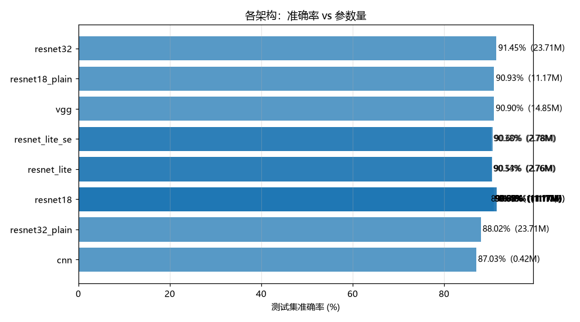

## 4. 多种子分组汇总（完整表见 `reports/summary_by_config.{csv,md}`）

| 配置 | 种子 | 测试准确率 mean ± std | min | max |
|---|---:|---:|---:|---:|
| ResNet-18 主模型（adam+cosine+增强） | 2 | **90.86% ± 0.05** | 90.82 | 90.90 |
| ResNet-18 / SGD | 2 | 91.02% ± 0.60 | 90.60 | 91.45 |
| ResNet-18 / Adam+StepLR | 2 | 90.71% ± 0.05 | 90.67 | 90.75 |
| 轻量化 ResNet | 2 | 90.43% ± 0.13 | 90.34 | 90.53 |
| 轻量化 ResNet + SE | 2 | 90.49% ± 0.16 | 90.38 | 90.60 |

> 单种子组（noaug / plain / resnet32 / vgg / cnn / cw 等）波动需谨慎解读，
> SGD 组两种子相差 0.85pp（90.60 vs 91.45），说明单种子的优化器排名在 6 类上不稳定。

## 5. 架构对比（同一配方、同一数据）

| 架构 | 参数量 | 测试准确率 | 相对 ResNet-18 |
|---|---:|---:|---:|
| ResNet-18 | 11.172 M | 90.86%（mean） | — |
| VGGNet-16 | 14.852 M | 90.90% | +0.04 pp（参数多 33%） |
| 轻量 CNN | 0.423 M | 87.03% | −3.83 pp |

- VGG-16 用 **1.33× 参数**只换来与 ResNet-18 持平的精度，且 Macro-F1 低 1.7pp（85.80 vs 87.50），
  说明纯卷积堆叠在困难类（sadness/fear）上更弱。
- 轻量 CNN 参数量只有 ResNet-18 的 1/26，精度低 3.8pp、Macro-F1 低 7.4pp，**性价比明显更差**。

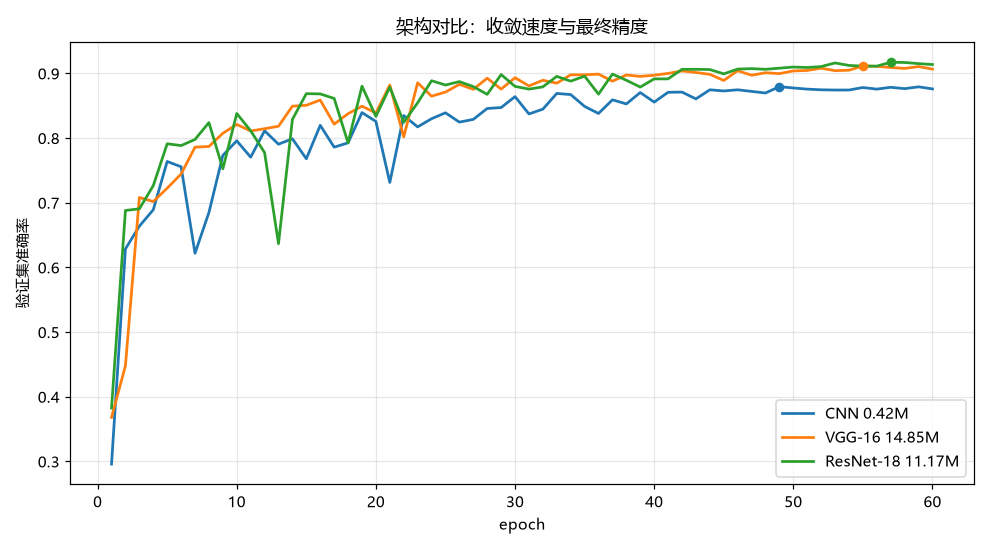

## 6. 深度与残差连接（核心机制）

**18 层同构消融（层数、参数量完全一致，只关掉恒等短路）**

| 模型 | 测试准确率 | Macro-F1 | 最佳验证 | 最佳轮泛化差距 |
|---|---:|---:|---:|---:|
| ResNet-18（残差，2 种子均值） | 90.86% | 86.88% | 91.55% | 0.064 |
| ResNet-18 无残差（同构） | 90.93% | 86.52% | 90.88% | 0.061 |

→ 在 18 层深度上，残差连接对最终精度**没有可见增益**（差异 +0.07pp 属噪声量级），
这与 5 类任务（91.59 vs 92.00，−0.41pp）一致：18 层还没深到出现退化。

**32 层深层退化实验**

| 模型 | 测试准确率 | Macro-F1 | 达 75% 验证轮次 | 最佳轮训练准确率 |
|---|---:|---:|---:|---:|
| ResNet-32（残差） | **91.45%** | 86.88% | 5 | 98.14% |
| ResNet-32（关闭残差） | 88.02% | 80.47% | **17** | 91.25% |
| 差距 | **−3.43 pp** | −6.41 pp | 慢 3.4× | 训不动（−6.9pp） |

→ 关掉残差后：收敛速度暴跌（到 75% 需 17 轮 vs 5 轮）、训练准确率卡在 91.25%（**典型退化**：
不是过拟合，泛化差距反而更小 0.030，而是**优化不动**）、测试精度低 3.43pp。
**6 类任务完整复现了 5 类任务的退化现象**（5 类：89.64 vs 92.11，−2.47pp）。

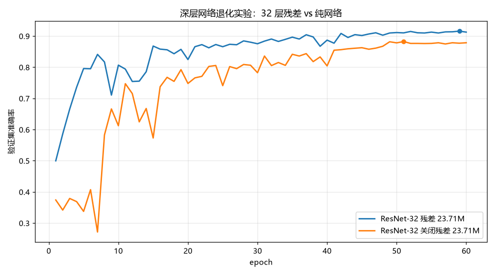
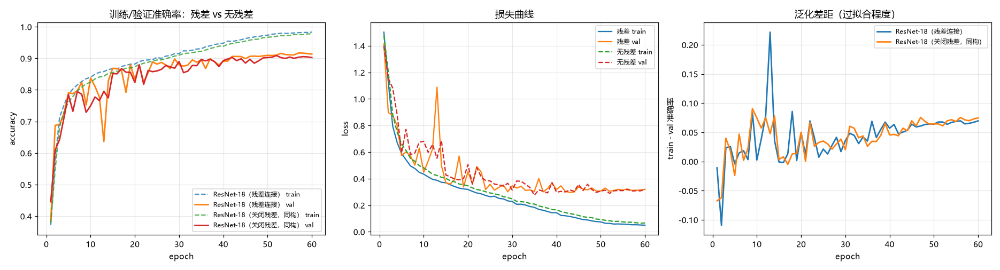

## 7. 数据增强消融

| 配置 | 测试准确率 | 最佳验证 | Macro-F1 |
|---|---:|---:|---:|
| 使用增强（主模型） | 90.86% | 91.55% | 86.88% |
| 关闭增强 | **91.49%** | 91.45% | 87.14% |

→ 关闭增强反而高 **0.63pp**（5 类为 +0.08pp，同方向）。原因：48×48 小图 + 已高度对齐的人脸，
随机裁剪/旋转会破坏表情线索；增强带来的正则化收益小于其信息损失。
注意两组验证准确率几乎相同（91.45 vs 91.55），**差距主要来自测试集波动，结论强度有限**。

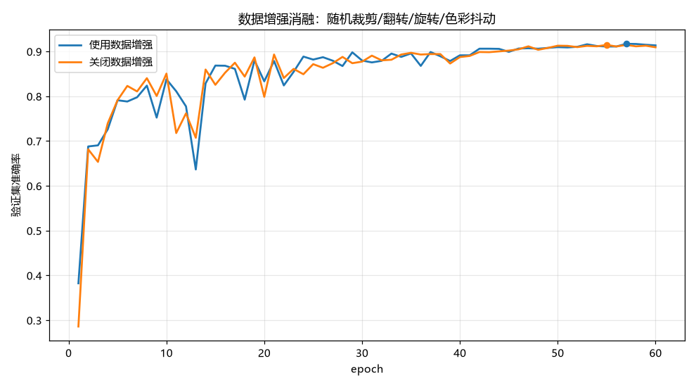

## 8. 优化器与学习率调度

| 配置 | 测试准确率（2 种子） | 达 75% 验证轮次 | 最佳轮泛化差距 |
|---|---:|---:|---:|
| Adam(1e-3) + Cosine | 90.86% ± 0.05 | 4–5 | 0.063 |
| SGD(0.1, mom0.9) + Cosine | 91.02% ± 0.60 | 8–13 | 0.055–0.060 |
| Adam + StepLR(20, 0.1) | 90.71% ± 0.05 | 4 | 0.035–0.051 |

- **Adam 收敛最快**（5 轮到 75%），SGD 需 8–13 轮，但 SGD 末期精度略高（两种子 90.60/91.45，均值 91.02%）。
- StepLR 与 Cosine 差 0.15pp，且 StepLR 在 epoch 20 骤降后**最佳轮常出现在早期（seed123 最佳轮 = 32）**，
  后半程收益有限；Cosine 的渐降更平稳（5 类同结论）。

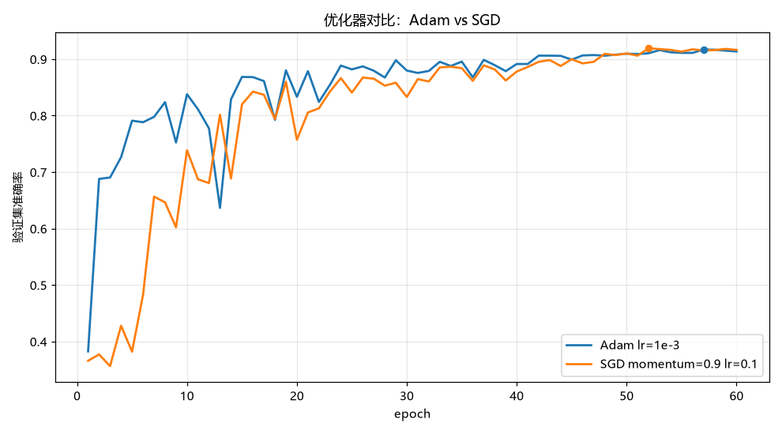
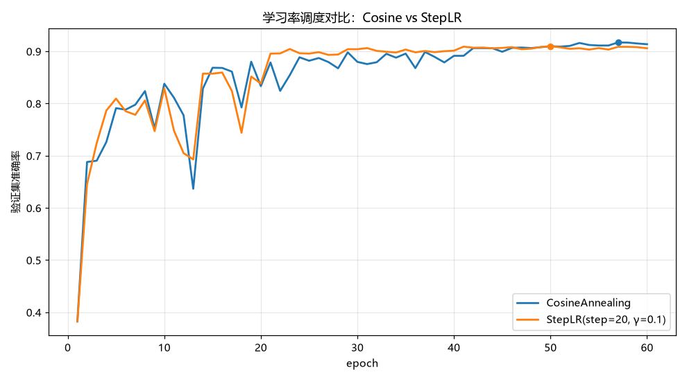

## 9. 轻量化 + SE 注意力

| 模型 | 参数量 | 测试准确率（2 种子） | 相对轻量化基线 |
|---|---:|---:|---:|
| 轻量化 ResNet | 2.759 M | 90.43% ± 0.13 | — |
| 轻量化 ResNet + SE | 2.783 M（+0.9%） | 90.49% ± 0.16 | **+0.06 pp** |
| ResNet-18（参照） | 11.172 M | 90.86% ± 0.05 | 参数 4× |

→ SE 在 6 类上只带来 +0.06pp（5 类为 +0.36pp），**增益不显著**；
但 2.78M 的轻量化网络已能到 90.49%，**用 1/4 参数达到大模型 99.6% 的精度**。

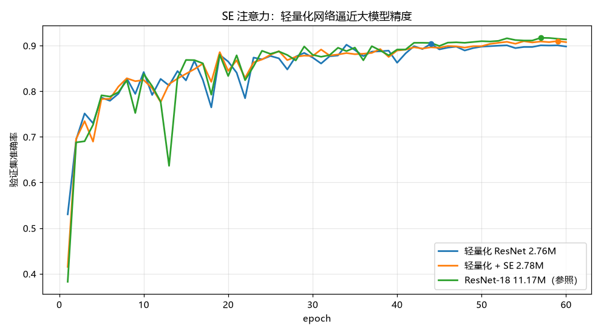

## 10. 类别不平衡：fear 与类别加权（6 分类特有）

fear 训练样本仅 343 张（1.58%），测试集仅 48 张。用逆频率权重
`w_c = N / (C · n_c)`（fear 权重约为 neutral 的 22 倍）重训：

| 指标 | 无权重（主模型） | 类别加权 CE | 变化 |
|---|---:|---:|---:|
| 测试准确率 | 90.90% | 89.86% | **−1.04 pp** |
| 平衡准确率 | 86.41% | **87.19%** | **+0.78 pp** |
| Macro-F1 | 87.50% | 86.19% | −1.31 pp |
| fear 召回 | 68.75% (33/48) | **75.00%** (36/48) | +6.25 pp |
| sadness 召回 | 79.32% | **83.73%** | +4.41 pp |
| neutral 召回 | 91.16% | 87.11% | −4.05 pp |

**逐类召回/F1（测试集）**

| 模型 | neutral | happiness | surprise | sadness | anger | fear |
|---|---:|---:|---:|---:|---:|---:|
| ResNet-18 召回 | 91.16 | 94.37 | 95.07 | 79.32 | 89.77 | 68.75 |
| ResNet-18 F1 | 90.73 | 95.19 | 93.18 | 78.52 | 90.61 | 76.74 |
| 类别加权 召回 | 87.11 | 94.49 | 93.04 | 83.73 | 89.77 | **75.00** |
| 类别加权 F1 | 90.04 | 94.98 | 91.71 | 76.47 | 88.94 | 75.00 |

→ 结论：**类别加权把少数类召回抬起来（fear +6.3pp、sadness +4.4pp、平衡准确率 +0.78pp），
代价是多数类（neutral −4.1pp）与总体准确率 −1.04pp**。Macro-F1 反而略降，说明权重过强、
fear 的假阳性同步增加（fear F1 76.74 → 75.00）。若下游更看重少数类，可取权重指数 α≈0.5
（`w_c = (N/(C·n_c))^α`）折中；本任务按统一配方以总体精度为主指标，故**主模型仍取无权重版**。

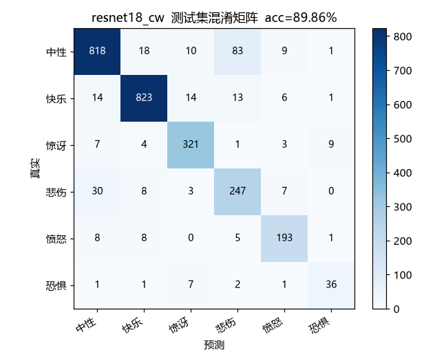

## 11. 错误分析（主模型，测试集 2713 张，错 247 张）

```
        neutral  happiness  surprise  sadness  anger   fear
neutral    856       18        9       51       5      0
happiness   30      822       10        6       3      0
surprise     6        4      328        1       2      4
sadness     47        6        1      234       7      0
anger        9        6        0        6     193      1
fear         0        0       11        3       1     33
```

- **悲伤 ↔ 中性互判 98 张**（51+47），占全部错误的 **39.7%**，仍是最大混淆对（5 类任务为 84/204 = 41%）。
- fear 漏判 15/48：11 张被判为 surprise、3 张 sadness——**fear 与 surprise 的视觉相似 + 样本太少**。
- 惊讶漏判 17 张中 4 张被判为 fear，两个稀有类互相混淆。
- 难度排序（按 F1）：happiness 95.19 > surprise 93.18 > neutral 90.73 > anger 90.61 > sadness 78.52 > fear 76.74。

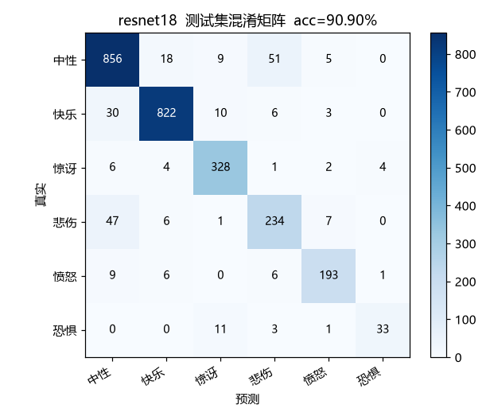

## 12. 5 分类 vs 6 分类横向对比

| 配置 | 5 类 | 6 类 | Δ |
|---|---:|---:|---:|
| ResNet-18 主模型（2 种子） | 92.00% | 90.86% | −1.14 |
| ResNet-32（残差） | 92.11% | 91.45% | −0.66 |
| ResNet-18 关闭增强 | 92.08% | 91.49% | −0.59 |
| ResNet-18 / SGD（2 种子） | 91.83% | 91.02% | −0.81 |
| ResNet-18 关闭残差 | 91.59% | 90.93% | −0.66 |
| ResNet-18 / StepLR（2 种子） | 91.53% | 90.71% | −0.82 |
| 轻量化 + SE（2 种子） | 91.42% | 90.49% | −0.93 |
| VGGNet-16 | 91.40% | 90.90% | −0.50 |
| 轻量化（2 种子） | 91.06% | 90.43% | −0.63 |
| ResNet-32 关闭残差 | 89.64% | 88.02% | −1.62 |
| 轻量 CNN | 89.07% | 87.03% | −2.04 |

- 平均仅下降 **0.95pp**：多出一个只占 1.58% 的极稀有类，对整体精度影响很小
  （因为 fear 本身占比低，判错它对总体准确率贡献 ≤1.6pp）。
- **下降最多的是弱模型**（CNN −2.04pp、32 层无残差 −1.62pp），强模型几乎无损（VGG −0.50、noaug −0.59）：
  新增困难类别主要考验模型的特征表达能力。
- 排名基本保持，但主模型不再是第一：6 类上 noaug(91.49) 与 ResNet-32(91.45) 略高于 ResNet-18(90.90)，
  差距都在 0.6pp 以内、属单种子波动范围。
- **5 类的全部结论在 6 类上复现**：残差缓解深层退化、Adam 收敛快于 SGD、StepLR 早停在较高位、
  增强收益有限、SE 增益微弱。

## 13. 梯度流分析（残差机制的定量证据，6 类数据）

对每个 Conv2d 输出激活取梯度，用 RMS = ‖g‖₂/√numel 消除张量尺寸影响：

| 网络 | 阶段 | 末层/首层 RMS | 每层几何衰减 | 动态范围 |
|---|---|---:|---:|---:|
| VGG-16（13 层纯卷积） | init | 1.4× | ×1.031 | 2.1 |
| ResNet-18 残差 | init | **20.5×** | ×1.172 | 25.2 |
| ResNet-18 无残差 | init | 36.3× | ×1.252 | 36.3 |
| ResNet-32 残差 | init | **68.1×** | ×1.128 | 123.5 |
| ResNet-32 无残差 | init | **477.9×** | ×1.213 | 477.9 |
| ResNet-32 残差 | 训练后 | 5.9×（首层 RMS 1.00e-5） | ×1.052 | 150.1 |
| ResNet-32 无残差 | 训练后 | 11.4×（首层 RMS 2.74e-6） | ×1.079 | 22.2 |

- 初始化时：**32 层纯网络末/首梯度差 477.9 倍，残差版仅 68.1 倍**（5 类：490.5 vs 77.6，
  两任务高度一致）；18 层为 36.3 vs 20.5（5 类：36.0 vs 20.3）。
- 训练后 32 层：纯网络**首层梯度 RMS 只有残差版的 27%**（2.74e-6 vs 1.00e-5），
  浅层几乎收不到学习信号 → 这正是退化实验中"训练准确率卡在 91.25%"的直接原因。
- 18 层训练后两者首层梯度基本相当（2.67e-6 vs 2.41e-6，纯网络反而略高），
  与"18 层残差对精度无增益"的结果互相印证。

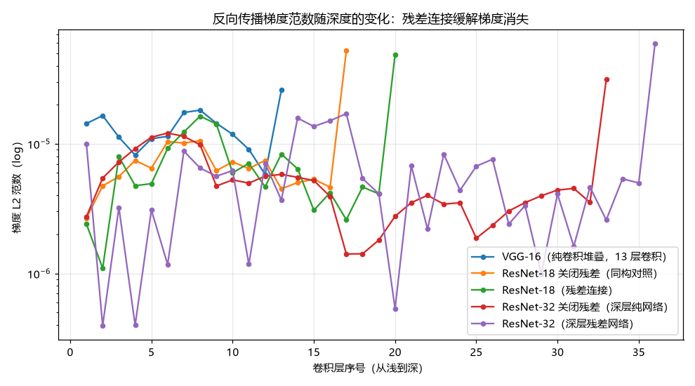
数据：`reports/grads/grad_norms.csv`、`reports/grads/grad_summary.json`

## 14. 结论

1. **6 分类任务达标**：ResNet-18 主模型 **90.86% ± 0.05（最高 90.90%）**，17 组全部 ≥ 87.03%，
   远超 78% 指标；Macro-F1 87.50%、平衡准确率 86.41%。
2. **ResNet 仍是最优架构**：同参数量下 Macro-F1 比 VGG-16 高 1.7pp、参数少 25%；
   轻量化版（2.78M）以 1/4 参数达到 99.6% 的精度。
3. **残差连接的价值在深层**：32 层关掉残差 → 精度 −3.43pp、收敛慢 3.4×、训练准确率卡住（退化），
   梯度分析给出同量级证据（init 末/首 477.9× vs 68.1×，训练后浅层梯度仅 27%）。
4. **类别不平衡的真实代价**：fear 只有 1.58%，无权重时召回 68.75%；逆频率加权把召回提到 75%、
   平衡准确率 +0.78pp，但总体精度 −1.04pp，**没有免费午餐**，需按业务目标取舍。
5. **错误结构稳定**：悲伤↔中性互判占错误的 39.7%，fear 主要被判成 surprise——
   数据层面补充 fear 样本比调结构更有效。

### 产物清单

- 结果 JSON：`reports/results/*.json`（17 组 + `_progress.json`）
- 总表：`reports/comparison.{csv,md}`、`reports/per_class.csv`、
  `reports/summary_by_config.{csv,md}`
- 曲线：`reports/curves/`（17 张单实验 + 8 张对比图）
- 混淆矩阵：`reports/confusion_*.png`（17 张）
- 权重：`checkpoints/*.pt`
- 梯度分析：`reports/grads/`、`reports/grad_norms.png`
- 复现命令：

```bash
python experiments.py --all          # 17 组
python make_report.py                # 总表
python analysis/compare_curves.py
python analysis/grad_analysis.py
```
